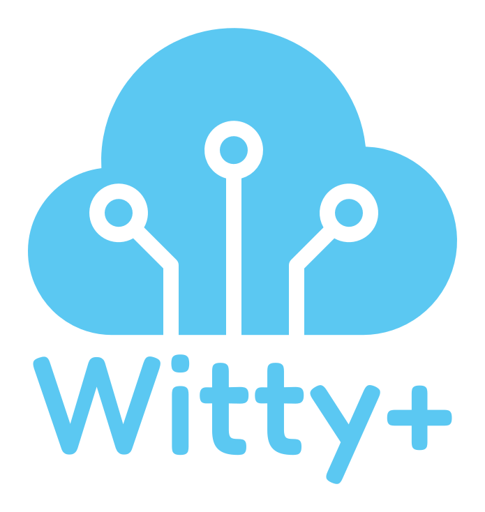

# Witty+ · Brand assets

Recursos públicos de la marca **Witty+**. Todo lo que está aquí se puede enlazar directamente (firmas de email, sitios web, documentos).

## Enlaces directos más usados
| Recurso | URL |
|---|---|
| Logo firma email | `https://raw.githubusercontent.com/Wittyplus/brand-assets/main/firma-email/witty-firma-logo.png` |
| Logo vertical SVG | `https://raw.githubusercontent.com/Wittyplus/brand-assets/main/svg/witty-logo-color.svg` |
| Logo horizontal SVG | `https://raw.githubusercontent.com/Wittyplus/brand-assets/main/svg/witty-logo-horizontal-color.svg` |
| Logo horizontal PNG 1200 | `https://raw.githubusercontent.com/Wittyplus/brand-assets/main/png/logo-horizontal/witty-logo-horizontal-color-1200px.png` |
| Isotipo PNG 512 | `https://raw.githubusercontent.com/Wittyplus/brand-assets/main/png/isotipo/witty-isotipo-color-512px.png` |
| Imagen Open Graph | `https://raw.githubusercontent.com/Wittyplus/brand-assets/main/social/og-image-1200x630.png` |
| Favicon | `https://raw.githubusercontent.com/Wittyplus/brand-assets/main/favicon/favicon.ico` |

> ⚠️ No renombres ni muevas `firma-email/witty-firma-logo.png`: las firmas de correo apuntan a esa URL.

---

## Colores
| Uso | HEX | RGB |
|---|---|---|
| Azul Witty (principal) | #5BC8F2 | 91, 200, 242 |
| Azul marino (alterno/contraste) | #0F3B57 | 15, 59, 87 |
| Blanco | #FFFFFF | 255, 255, 255 |

## Tipografía
Wordmark en **Fredoka Medium** (Google Fonts, licencia libre OFL). En los SVG el texto está convertido a curvas, así que no necesitas la fuente instalada. La fuente está en `fuente/` para usarla en piezas de diseño.

## Carpetas
- `lamina-de-marca.png`: resumen visual de la marca.
- `svg/`: vectores maestros (logo vertical, horizontal e isotipo) en color, navy, blanco y negro.
- `png/logo-vertical/`: 512, 1024, 2048 y 4096 px, fondo transparente (+ versión blanca sobre azul).
- `png/logo-horizontal/`: 600, 1200 y 2400 px, fondo transparente.
- `png/isotipo/`: solo la nube, 256/512/1024 px.
- `favicon/`: favicon.ico, favicon.svg, apple-touch-icon, android-chrome, maskable, mstile, safari-pinned-tab, site.webmanifest, browserconfig.xml y `head-snippet.html` con el código para el `<head>`.
- `social/`: Open Graph 1200×630, header X/Twitter, banner LinkedIn y fotos de perfil 1080×1080.
- `firma-email/`: firma HTML para Gmail/Outlook/Apple Mail, logo para la firma y guía `COMO-INSTALAR.md`.
- `fuente/`: Fredoka (archivo variable).

## Uso
- Versión **blanca** solo sobre fondos azules u oscuros; **color** o **navy** sobre fondos claros.
- Deja un margen libre alrededor del logo equivalente a la altura de la "t".
- No deformes, rotes ni cambies los colores fuera de esta paleta.
